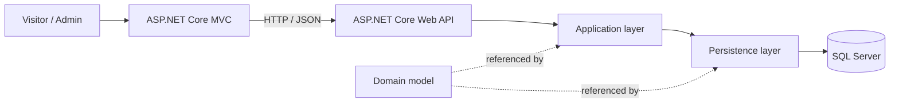

# CarBook

<p align="center">
  <strong>A modern car rental platform built with ASP.NET Core</strong><br>
  Browse vehicles, explore rental options, and manage the platform through a dedicated admin area.
</p>

<p align="center">
  
  
  
  
</p>

## Overview

CarBook is a full-stack car rental application composed of an ASP.NET Core MVC web interface and a separate REST API. Visitors can discover cars and rental pricing, while administrators can manage the content and data that power the platform.

The codebase is organized into application, persistence, API, and frontend projects. It uses Entity Framework Core for data access and applies CQRS, Mediator, and Repository patterns in the application layer.

## Certificate Program

This project was developed as part of the certificate program shown below.

<p align="center">
  
</p>

## Features

- **Vehicle catalog** — browse cars and view car details alongside their brands.
- **Rental options** — explore pricing periods, locations, and vehicle availability.
- **Reservations** — submit rental reservation requests.
- **Editorial content** — browse blogs, authors, comments, and related content.
- **Admin area** — manage cars, brands, features, and other site content.
- **REST API** — HTTP endpoints for cars, brands, reservations, blogs, and more.
- **API documentation** — Swagger UI is enabled in the Development environment.

## Technology

| Area | Technologies |
| --- | --- |
| Framework | .NET 8, ASP.NET Core MVC, ASP.NET Core Web API |
| Data access | Entity Framework Core, SQL Server |
| Application patterns | CQRS, MediatR, Repository |
| API documentation | Swagger / OpenAPI |
| Frontend assets | Razor views and static web assets |

## Architecture



### Projects

| Project | Responsibility |
| --- | --- |
| `Core/UdemyCarBook.Application` | Use cases, CQRS handlers, Mediator handlers, repository contracts, and application services |
| `Frontends/UdemyCarBook.Dto` | Data transfer objects shared with the web interface |
| `Frontends/UdemyCarBook.WebUI` | Public-facing MVC website and Admin area |
| `Infrastructure/UdemyCarBook.Persistence` | Entity Framework Core context, repositories, and database migrations |
| `Presentation/UdemyCarBook.WebApi` | REST API controllers and Swagger configuration |
| `UdemyCarBook.Domain` | Domain entities referenced by the application and persistence projects |

## Getting Started

### Prerequisites

- .NET 8 SDK
- SQL Server LocalDB (the default database configuration uses `(localdb)\MSSQLLocalDB`)
- The `UdemyCarBook.Domain` project referenced by the solution

> **Domain project dependency:** The project files reference `UdemyCarBook.Domain` as a sibling directory (`..\UdemyCarBook.Domain`), but that project is not included in this repository. Make it available at that path before restoring or building the solution.

### 1. Restore dependencies

Run these commands from the repository root:

```powershell
dotnet restore Presentation\UdemyCarBook.WebApi\UdemyCarBook.WebApi.csproj
dotnet restore Frontends\UdemyCarBook.WebUI\UdemyCarBook.WebUI.csproj
```

### 2. Create or update the database

The persistence project includes Entity Framework Core migrations. Install the EF Core CLI tool if it is not already available, then apply the migrations:

```powershell
dotnet tool install --global dotnet-ef
dotnet ef database update `
  --project Infrastructure\UdemyCarBook.Persistence\UdemyCarBook.Persistence.csproj `
  --startup-project Presentation\UdemyCarBook.WebApi\UdemyCarBook.WebApi.csproj
```

The current `CarBookContext` configures a local SQL Server database named `UdemyCarBookDb`. Update the context configuration if you need to use a different SQL Server instance.

### 3. Start the API

In a terminal, run:

```powershell
dotnet run --project Presentation\UdemyCarBook.WebApi\UdemyCarBook.WebApi.csproj --launch-profile https
```

The HTTPS profile listens at `https://localhost:7294` and `http://localhost:5044`. In Development, Swagger UI is available at [`https://localhost:7294/swagger`](https://localhost:7294/swagger).

### 4. Start the web interface

In a second terminal, run:

```powershell
dotnet run --project Frontends\UdemyCarBook.WebUI\UdemyCarBook.WebUI.csproj --launch-profile https
```

Open [`https://localhost:7099`](https://localhost:7099). The web interface currently sends API requests to `https://localhost:7294`, so start the API with its HTTPS profile first.

## API at a Glance

API routes use the `/api/{controller}` convention. For example:

| Method | Route | Description |
| --- | --- | --- |
| `GET` | `/api/Cars` | List cars |
| `GET` | `/api/Cars/{id}` | Get a car by ID |
| `POST` | `/api/Cars` | Create a car |
| `PUT` | `/api/Cars` | Update a car |
| `DELETE` | `/api/Cars/{id}` | Remove a car |
| `GET` | `/api/Brands` | List brands |
| `POST` | `/api/Reservations` | Create a reservation |

Explore the Swagger UI while the API is running for the available controllers and endpoint details.

## Configuration Notes

- The API and MVC application have separate launch profiles; run them as separate processes during local development.
- The MVC controllers currently use the API address `https://localhost:7294`. If the API uses another address, update the URLs used by the web controllers as well.
- Database configuration currently lives in `CarBookContext`. Avoid committing credentials or other sensitive configuration if you adapt it for a remote database.
